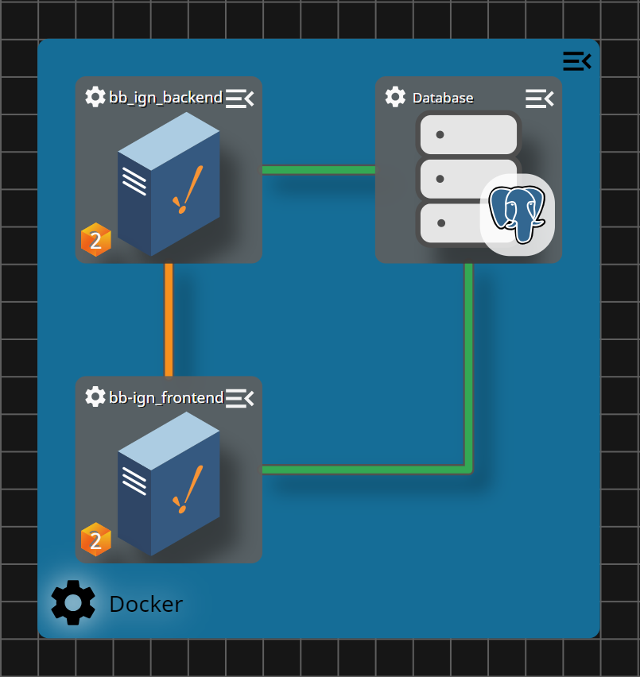

# Ignition Bug Bounty

This repository is used as a testing stack for the Ignition 8.3.9 bug bounty

# How It Works

* Tag data, Tag history, Alarm event data, Alarm Journal, and Audit logs communicate over the Gateway Network

  

# Setup
* Open current dir in your IDE of choice
* Run `docker compose up -d`

# User Accounts Info

* Oscar the Operator
	* User: OscarP
	* Password: PowerfulPlants39!
* Maggie the Manager
	* User: MaggieA
	* Password: AmpleAlters@4
* Adam the Admin (GW Config & Designer)
	* User: AdamD
	* Password: DancingDove5%

# Gateway Info

Backend Gateway Webpage https://backend.localtest.me:18043

Frontend Gateway Webpage https://frontend.localtest.me:28043

Database `localhost:15432`
